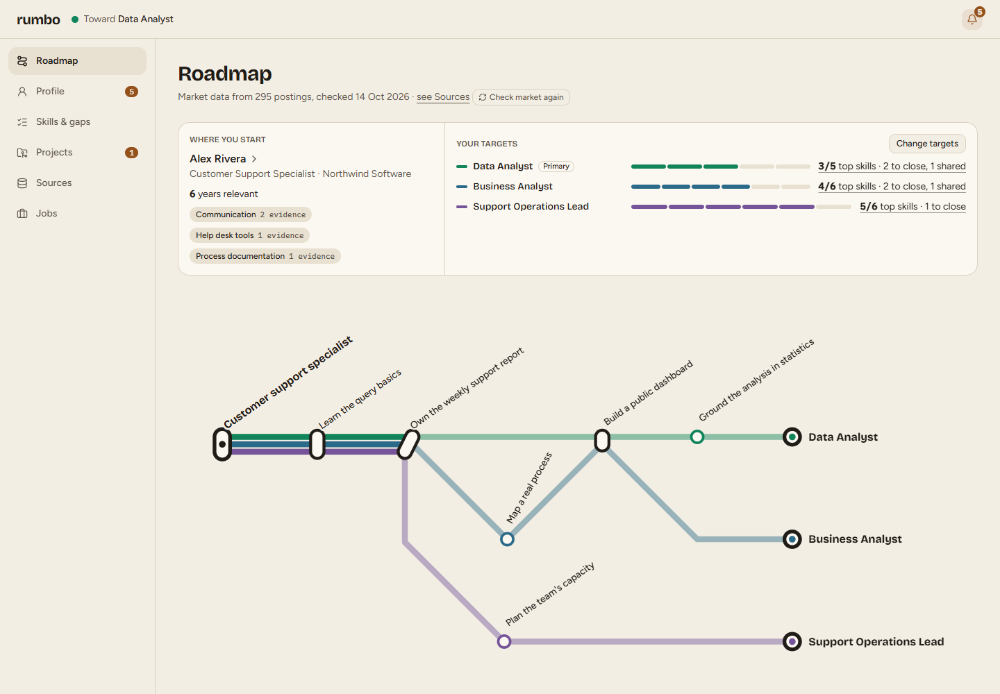

# rumbo

A multi-agent assistant for a job search, end to end (built tech-first, open to any field): it reads your professional profile, surveys the market with real job postings from public sources, measures your skills against them with evidence, helps you choose a target role and a roadmap where every gap has a verifiable way to close it (a project, a work experience or a course), drafts LinkedIn/CV changes you approve, and tracks progress — including automatic analysis of every push to the roadmap's project repos.

> **Status:** Phase 0 complete (product docs and ADRs). Next: local walking skeleton. Runs locally only until auth exists.

## Why it exists

Besides being useful, rumbo is a portfolio piece for AI engineering: real agentic workflows, model routing in production, evals in CI, per-run tracing and explicit cost control. The engineering decisions are documented as ADRs.

## Roadmap demo



A front-end slice of the web app, built ahead of the API with contract-typed mock data ([spec 01](docs/specs/01-roadmap-demo.md), epic #99). It shows a fictional user, Alex Rivera, a customer support specialist aiming at three targets (Data Analyst, Business Analyst, Support Operations Lead), after onboarding:

- **Roadmap:** a summary band (where you start, your targets and how much of each target's market demand your evidence covers), then the plan as a subway map. Each target is a line, each station an objective, and a station several targets need is an interchange. Pick a line to list its stations, and open any station for its deliverables, `doneWhen`, tasks, evidence and dates.
- **Profile, Skills & gaps, Projects:** the same plan seen as a CV you can edit, as market numbers behind every gap, and as practice projects whose evidence you approve. An approval updates every tab at once.
- **Sources and Jobs** show their Planned state.

A 10–12 minute walkthrough is in [docs/demo-script.md](docs/demo-script.md).

### Run it

```bash
docker compose up --build --wait
```

Open http://localhost:3000, which goes to Roadmap. Without a `.local/mocks/` folder the app shows the fictional user, the same one tests and CI use.

### Design decisions and trade-offs

- **Contracts first, mocks behind one door.** The mocks follow the shapes of ADR 0004 (`packages/contracts`), and components read them only through `apps/web/src/lib/data` (an ESLint rule enforces it). When the API serves real data, `lib/data` changes and `mocks/` is deleted; no view changes.
- **Domain and geometry are separate.** `Roadmap` is what an agent will produce; `RoadmapLayout` (grid positions and color slots) is hand-authored presentation. Interchanges, routes and "you are here" are derived by code (`deriveRoadmapView`), never authored, so they cannot disagree with the data. A missing or invalid layout degrades to the single-line list instead of failing.
- **The map is decoration over an accessible list.** The SVG is `aria-hidden`; the stations are a focusable list with roving tabindex, so keyboard and screen readers get the same plan. The station panel is a Base UI dialog (side sheet on desktop, bottom sheet on phones). Phones get the single line, not the map.
- **One store, one progress rule.** State that several tabs read (the plan's progress, the edited profile, decisions on evidence and suggested changes) lives in one Zustand store per request, and `lib/progress.ts` derives every status from it. Approving a commit on Projects completes its task, and the deliverable, the station and the tab badge update with it.
- **Human approval and facts vs. opinion are visible.** Anything an agent would propose waits as "awaiting approval" with Approve/Reject; market numbers are styled as data, apart from the model's rationale.
- **"Field notes" direction.** Paper tones, three line colors at ≥ 3:1 and text at ≥ 4.5:1 in light and dark (measured by `apps/web/test/theme.test.ts`), Bricolage Grotesque, Figtree and IBM Plex Mono. Every animation is cut under `prefers-reduced-motion`.
- **Performance.** Lighthouse on `/roadmap` (compose build): 100 performance and 100 accessibility on desktop; 93 and 100 on mobile. Mobile stays under 95 because React and Next hydrate about 210 KB of JS before the first paint on localhost; the next cut is loading the dialog on first open (#194).
- **Local only.** Nothing is deployed until real auth exists.

### Out of scope

The demo stops where real data starts. Onboarding and changing targets (F2b, documented in [views.md](docs/product/views.md) and shown as a read-only explainer), real profile extraction (F1), market search (F2), the gap and roadmap agents (F3), drafting and export (F4) and repo tracking (F5) are later slices; the full table is in [spec 01](docs/specs/01-roadmap-demo.md#out-of-scope-stays-in-the-plan). The streamed "Analyze my progress" (#118) was dropped: the first real model calls, with routing, evals and a cost ledger, come with the market radar.

## Docs

- Product: [problem](docs/product/problem.md) · [MVP scope](docs/product/mvp-scope.md) · [walking skeleton](docs/product/walking-skeleton.md) · [cross-cutting concerns](docs/product/cross-cutting.md)
- Architecture decisions: [docs/adr](docs/adr)
- Specs per vertical slice: [docs/specs](docs/specs)
- Backlog: [docs/backlog.md](docs/backlog.md)

## Repository layout

```
apps/web            Next.js (App Router)
apps/api            NestJS (HTTP + webhooks)
apps/worker         queue consumer: agent runs and push analysis
packages/db         Prisma schema, migrations and client
packages/config     environment validation shared by every service
packages/logger     JSON logging with PII redaction
packages/contracts  shared Zod schemas and types
packages/agents     agent definitions, versioned prompts and tools
packages/router     routing policy, cascade, budget and cost ledger
packages/mcp-jobs   MCP server for job postings
evals/              golden sets and runner
docs/               product docs, ADRs, specs
```

## Requirements

Node 24 (see `.nvmrc`) and pnpm. A version manager that reads `.nvmrc` is recommended, e.g. [fnm](https://github.com/Schniz/fnm) with `--use-on-cd`. Enable pnpm with `corepack enable pnpm` (it uses the exact version pinned in `package.json` → `packageManager`); `npm install -g pnpm` also works.

```bash
pnpm install
pnpm typecheck
```

## Run in development

From the repository root, after `pnpm install`:

```bash
pnpm dev:web     # web only, at http://localhost:3000 (WEB_PORT)
pnpm dev:api     # API only, at http://localhost:3001
pnpm dev:worker  # worker only
pnpm dev         # web, API and worker together
```

The API and worker commands require Docker. They start only the compose `postgres` service, build
shared packages, apply migrations, then recompile and restart each app as its source changes. The
web command uses Next.js development mode. All of them read the repo-root `.env` and listen on
`127.0.0.1` only. Stop the
prod-like stack first (`docker compose down`): both serve the web app on port 3000. Node 24 is
required. On Windows PowerShell, use `pnpm.cmd` if `pnpm.ps1` is blocked.

## Run it locally (prod-like)

Requires Docker. Builds the production images and starts Postgres + pgvector, a one-off migration step, the API, the worker and the web app. Everything binds to `127.0.0.1` only.

```bash
docker compose up --build --wait
```

Open http://localhost:3000 for the app (it opens Roadmap), or http://localhost:3000/status for the status page (API, database, last worker heartbeat). Every variable has a default; copy `.env.example` to `.env` to change ports or credentials.

API docs (Swagger UI) are at http://localhost:3000/api/docs, and the OpenAPI document at http://localhost:3000/api/docs/openapi.json. The document is generated at boot; documented request and response schemas come from the Zod schemas in `packages/contracts`, and every endpoint includes the standard error envelope.

With the stack up, run the end-to-end smoke test (installs Chromium the first time):

```bash
pnpm --filter @rumbo/e2e exec playwright install chromium
pnpm test:e2e
```
